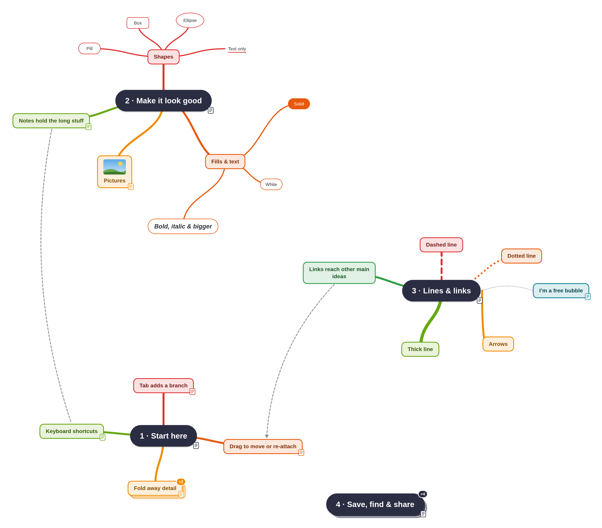

# Spider Diagram

Make spider diagrams (mind maps) quickly with the keyboard, then export them as pictures or as notes for Word, Google Docs or Markdown.

## Download

| Your computer | Download | Then |
|---|---|---|
| **Windows** | [spider-diagram-windows.cmd](https://github.com/BannerZerk46/spider-diagram/releases/latest/download/spider-diagram-windows.cmd) | Double-click it. If Windows says "Windows protected your PC", click **More info → Run anyway**. |
| **Mac** | [spider-diagram-mac.zip](https://github.com/BannerZerk46/spider-diagram/releases/latest/download/spider-diagram-mac.zip) | Unzip it and double-click `spider-diagram-mac.command`. The first time, right-click it and choose **Open**. |
| **Linux** | [spider-diagram-linux](https://github.com/BannerZerk46/spider-diagram/releases/latest/download/spider-diagram-linux) | Make it runnable (`chmod +x spider-diagram-linux`) and run it. |
| **Chromebook** (or any browser) | [spider-diagram-chromeos.html](https://github.com/BannerZerk46/spider-diagram/releases/latest/download/spider-diagram-chromeos.html) | Open it in your browser. |

The Windows, Mac and Linux versions need **Python 3.8 or newer** ([python.org](https://www.python.org/downloads/); on Windows, tick "Add python.exe to PATH" while installing). They open the app in your web browser and give it proper Save / Open dialogs and a homepage of all your diagrams.

On Windows and Linux, the app's homepage offers to **install** it, adding it to your Start menu / apps menu and making `.spider` files open with it. Installed copies **update themselves**: when a new version comes out, the app offers to update in one click.

All versions: [releases page](https://github.com/BannerZerk46/spider-diagram/releases).

## What it can do

- <kbd>Tab</kbd> adds a branch, <kbd>Enter</kbd> adds a sibling, and you just type to fill them in
- Auto-tidy keeps everything neatly arranged, in rainbow colours that fade along each branch
- Pictures in bubbles, and notes with headings, lists, tables and pictures for anything longer
- Fold branches away, several main ideas in one file, and free-floating bubbles
- Links between any two bubbles, with labels, arrows, and dashed or dotted lines
- Export as a PNG picture, a Word document, Markdown or plain text
- Light and dark mode, and a step-by-step tutorial the first time you open it

## For developers

`index.html` is the whole app, `spider-diagram.py` is the launcher, and `build.py` packs them into the single-file versions in `dist/`. To publish a new version: `python3 release.py "What changed"` (builds, commits, pushes, and creates the GitHub release).
